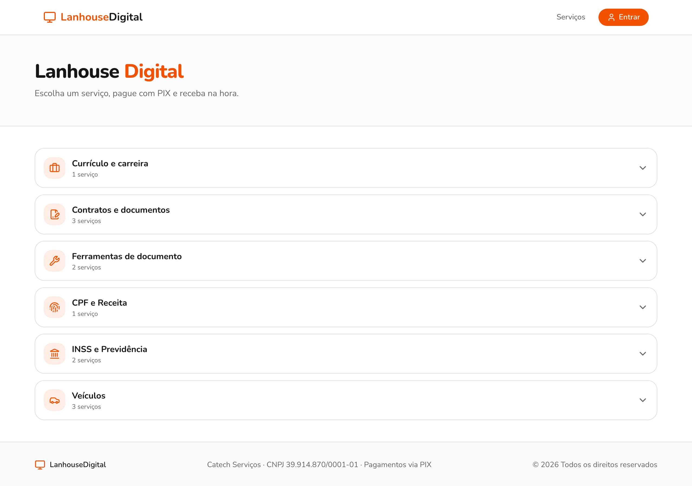
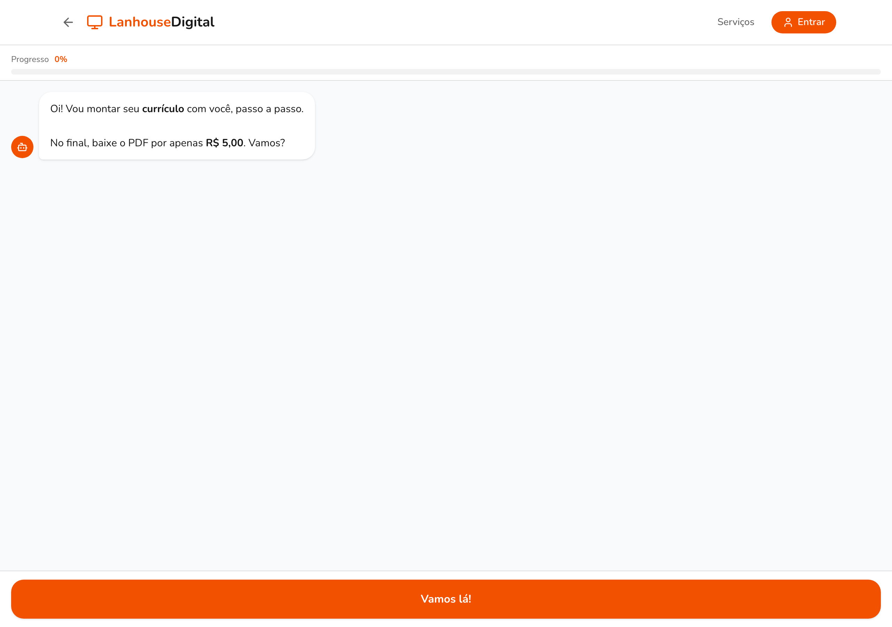
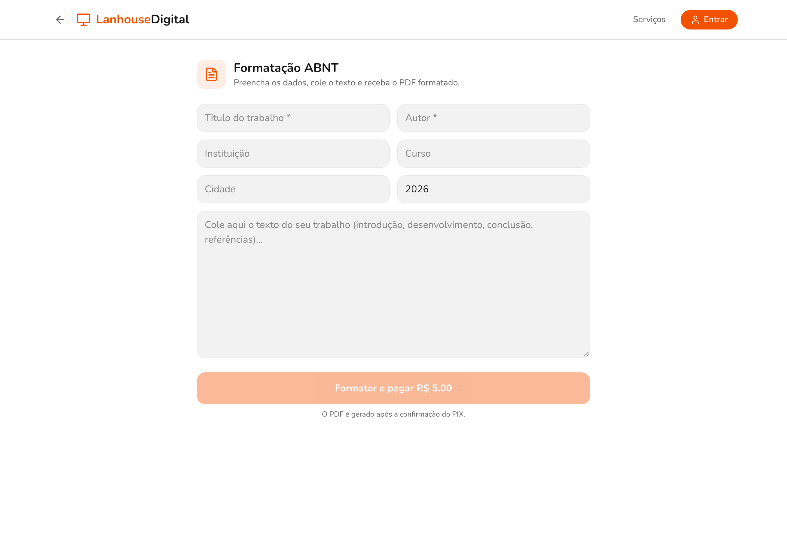

# Lanhouse Digital

Lanhouse Digital is a web storefront of small digital services for walk-in
customers of a neighborhood internet cafe: the customer picks a service, pays
with PIX, and receives the result on the spot. Some services are produced in the
app itself (AI helpers and local PDF generation), and others guide the customer
to the official government portal that provides the document for free.

This is an educational portfolio project. It talks to real third-party services
(Anthropic, Supabase, Asaas). Run it with sandbox keys and without real personal
data.

## Features

- PIX payments through Asaas: dynamic QR code charge per service, status
  polling, and a webhook that confirms payment and activates access.
- Subscription and entitlement: monthly or yearly plan via Asaas; a subscriber
  with an active plan gets access without paying per service.
- AI contract review: upload or paste a contract and get a structured review
  (Anthropic SDK).
- AI resume/CV review: guided chat that drafts and reviews a resume.
- Resume generator: step-by-step chat that builds a resume and exports it as a
  PDF.
- Contract generator: residential and commercial lease and service agreements,
  rendered to PDF.
- ABNT formatter: formats academic text to the Brazilian ABNT standard.
- Document organizer: reorders and assembles PDF pages.
- Local PDF generation with jsPDF (no server round trip for the generated
  documents).
- Assisted services: a chat bot collects the customer data, charges the PIX, and
  produces a local data sheet in PDF (for example, CPF status).
- Redirect services: the app sends the customer to the official free portal
  (INSS, Receita Federal, DETRAN) with step-by-step instructions.
- Authentication with NextAuth v5 (Google sign-in).

## Screenshots

| Storefront | Resume helper | ABNT formatter |
| --- | --- | --- |
|  |  |  |

## Architecture

- Next.js 16 (App Router) with React 19 and TypeScript. Pages and API routes
  live under `src/app`.
- Supabase (Postgres) is the database, accessed only on the server with the
  service role key. The schema is in `db/schema.sql`.
- Asaas handles PIX charges, subscriptions, and the payment webhook.
- Anthropic (Claude) powers the AI helpers through the official SDK.
- Tailwind CSS 4 and shadcn-style components (`src/components/ui`).
- jsPDF generates the PDFs in the browser.

This Next.js version has breaking changes relative to older releases. See
`AGENTS.md` and consult `node_modules/next/dist/docs/` before changing framework
APIs (routing, params, metadata).

## Route and module map

```
src/
  app/
    page.tsx                 # storefront home (service catalog)
    api/
      abnt/                  # ABNT formatter (Anthropic)
      contrato/revisar/      # AI contract review (Anthropic)
      curriculo-review/      # AI resume/CV review (Anthropic)
      organizador/           # document organizer (Anthropic)
      pix/create/            # creates the Asaas PIX charge
      pix/status/[orderId]/  # polls payment status
      webhooks/asaas/        # Asaas payment webhook
      auth/[...nextauth]/    # NextAuth v5 handler
      me/                    # current session/entitlement
    abnt/                    # ABNT formatter page
    atendimento/[slug]/      # assisted-service chat bots
    contrato/[tipo]/         # contract generator
    curriculo/               # resume generator + PDF
    organizador/             # document organizer page
    conta/                   # account and subscription pages
    servico/[slug]/          # redirect-service detail page
  components/                # UI, including ui/ (shadcn-style primitives)
  lib/
    services.ts              # service catalog (source of truth)
    asaas.ts                 # Asaas integration
    supabase.ts              # server-only Supabase client
    subscriptions.ts         # plans and entitlement
    access.ts                # paid-access check
    atendimento/, contratos/, abnt/, organizador/  # per-feature logic and PDF
db/
  schema.sql                 # Supabase schema
```

## Requirements

- Node.js 20 or newer
- Supabase project (Postgres)
- Google OAuth credentials (sign-in)
- Anthropic API key
- Asaas account (use the sandbox environment for testing)

## Running locally

```bash
npm install
cp .env.example .env.local   # fill in the values
npm run dev                  # http://localhost:3000
```

Create the database schema by running `db/schema.sql` in the Supabase SQL editor.
Generate `AUTH_SECRET` with `npx auth secret`.

In development, set `PAYMENT_BYPASS=true` to use the app without paying. The flag
is ignored in production (`NODE_ENV=production`).

### Environment variables

All variables are documented in `.env.example`. None are committed with real
values. The app reads them lazily, so it builds without them; they are required
only to actually run the corresponding feature.

| Variable | Used for |
| --- | --- |
| `ANTHROPIC_API_KEY` | AI helpers (contract review, resume, ABNT, organizer) |
| `AUTH_SECRET` | NextAuth session encryption |
| `AUTH_GOOGLE_ID`, `AUTH_GOOGLE_SECRET` | Google sign-in |
| `AUTH_TRUST_HOST` | set to `true` behind a proxy |
| `SUPABASE_URL`, `SUPABASE_SERVICE_ROLE_KEY` | server-side database access |
| `ASAAS_API_KEY` | Asaas API authentication |
| `ASAAS_BASE_URL` | Asaas endpoint (sandbox by default) |
| `ASAAS_CUSTOMER_ID` | reuse an existing Asaas receiver customer (optional) |
| `ASAAS_WEBHOOK_TOKEN` | validates the Asaas webhook request |
| `BUSINESS_CNPJ` | receiver CNPJ shown on the charge |
| `NEXT_PUBLIC_BUSINESS_WHATSAPP` | counter WhatsApp number |
| `PAYMENT_BYPASS` | development only: skip payment |

## Scripts

| Command | Description |
| --- | --- |
| `npm run dev` | Development server |
| `npm run dev:https` | Development server with experimental HTTPS |
| `npm run build` | Production build |
| `npm run start` | Serve the production build |
| `npm run lint` | ESLint |
| `npm run test` | Vitest |

## Testing

```bash
npm run test
```

The suite covers the validators (CPF/CNPJ), the contract models, and the
contract integration. The CPF `529.982.247-25` that appears in the tests is a
public example value used for validation.

## Deployment

The app targets Firebase App Hosting (Next.js with SSR and API routes).
Configuration is in `apphosting.yaml`; secrets live in Secret Manager.

## Limitations and educational note

This is a personal portfolio project, not a production service. It integrates
with real third-party APIs and should be run with sandbox credentials and
without real personal data. The redirect services only link to the official
government portals; the app does not automate those portals.
